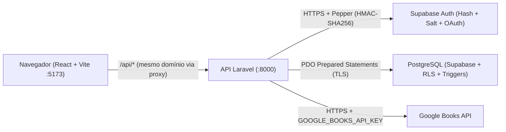

# Guia de Apresentação — GuMa: Sistema de Biblioteca

Este documento serve como **roteiro técnico completo** para apresentar o projeto **GuMa**. Ele explica a arquitetura, os arquivos essenciais (pasta por pasta), o fluxo passo a passo desde a entrada no site até o painel dos bibliotecários, como o `.env` alimenta o sistema e todas as camadas de segurança implementadas.

---

## 1. Visão Geral da Arquitetura (Padrão BFF)

O projeto usa o padrão **BFF (Backend for Frontend)**: o navegador (React) **nunca** conversa diretamente com o banco de dados, nem com o Supabase Auth, nem com a Google Books API. Todas as chamadas passam pelo **Laravel**, que centraliza sessão, CSRF, permissões, logs, cache e segredos.



**Por que isso é importante na apresentação:**
- Nenhuma chave secreta (`DB_PASSWORD`, `SUPABASE_SECRET_KEY`, `PASSWORD_PEPPER`, `GOOGLE_BOOKS_API_KEY`, `APP_KEY`) vai para o código JavaScript do navegador.
- Nenhum JWT ou `refresh_token` fica em `localStorage` ou `sessionStorage` — o navegador recebe apenas um **cookie de sessão `HttpOnly`** criptografado pelo Laravel.

---

## 2. Mapa de Pastas e Arquivos Essenciais (O que mostrar)

Abaixo estão apenas os arquivos centrais que vale a pena abrir e explicar durante a apresentação:

### 📁 `database/` (Estrutura e Regras no PostgreSQL / Supabase)
- **`01_base_supabase.sql`**: cria todas as tabelas principais (`bibliotecas`, `autores`, `clientes`, `bibliotecarios`, `livros`, `emprestimos`, `solicitacoes`), chaves estrangeiras (`ON DELETE RESTRICT`), índices, trigger que cria o perfil em `clientes` ao cadastrar no Auth, triggers de ajuste automático de estoque e políticas de **RLS (Row Level Security)**.
- **`02_extensoes_catalogo.sql`**: adiciona colunas de catálogo (`sinopse`, `imagem_capa_url`, `destaque`, `ano_publicacao`) e índices de busca.
- **`04_api_somente_laravel.sql`**: bloqueia acesso direto às tabelas pelos papéis públicos (`anon` / `authenticated`) do Supabase, garantindo que toda operação passe obrigatoriamente pela API Laravel.
- **`06_reforcos_integridade.sql`**: reforça integridade de negócio no banco — impede empréstimo duplicado ativo do mesmo livro pelo mesmo cliente e bloqueia `DELETE` na tabela `emprestimos` para preservar o histórico de auditoria.

### 📁 `backend/` (API REST e Segurança em Laravel 12 / PHP 8.3)
- **`.env` e `.env.example`**: guarda as variáveis sensíveis (credenciais do banco, chaves do Supabase, chave do Google Books, `PASSWORD_PEPPER`, `APP_KEY`). O `.env` real fica fora do Git (`.gitignore`).
- **`config/` (`database.php`, `services.php`, `session.php`, `cors.php`)**: camada que lê o `.env` via `env(...)` e expõe os valores para a aplicação via `config(...)`.
- **`routes/api.php`**: mapa de todas as rotas da API, separadas em 3 níveis:
  1. **Públicas:** `/health`, `/auth/*`, `/livros`, `/livros/destaques`, `/livros/{id}`, `/google-books`
  2. **Autenticadas (`supabase.auth`):** `/auth/me`, `/me`, `/me/emprestimos`, `/me/solicitacoes`
  3. **Restritas a bibliotecários (`bibliotecario`):** `/admin/dashboard`, `/admin/livros` (`GET/POST/PATCH/DELETE`), `/admin/autores`, `/admin/bibliotecas`, `/admin/solicitacoes`, `/admin/emprestimos`, `/admin/clientes`
- **`app/Http/Middleware/`**:
  - **`AuthenticateSupabase.php`**: verifica se há sessão ativa, renova token expirado usando `refresh_token`, valida o usuário no Supabase Auth (`/auth/v1/user` com cache de 30s) e carrega os registros de `clientes` e `bibliotecarios` na requisição.
  - **`EnsureBibliotecario.php`**: bloqueia com HTTP `403` qualquer usuário que não esteja na tabela `bibliotecarios` e registra a tentativa em `Log::warning`.
  - **`NoCacheApi.php`**: adiciona cabeçalhos `no-store` nas respostas da API.
- **`app/Http/Controllers/Api/`**:
  - **`SessionController.php`**: cuida de CSRF (`/auth/csrf`), cadastro (`/auth/register`, com fallback administrativo caso o limite de e-mail do Supabase seja atingido), login por e-mail (`/auth/login`), login Google OAuth com PKCE (`/auth/google` e `/auth/google/callback`), perfil atual (`/auth/me`) e encerramento de sessão (`/auth/logout`). Também aplica o `PASSWORD_PEPPER`.
  - **`CatalogController.php`**: lista, filtra, exibe detalhes e destaques dos livros usando cache versionado (`Catalog::version()`).
  - **`GoogleBooksController.php`**: consulta a Google Books API pelo servidor com cache por termo buscado.
  - **`MeController.php`**: área do leitor — ver/editar perfil, listar empréstimos e solicitações, solicitar livro (`POST /me/solicitacoes`) e cancelar solicitação pendente.
  - **`AdminController.php`**: painel da equipe — dashboard, cadastro de autores/bibliotecas, CRUD completo de livros (`createBook`, `updateBook`, `deleteBook`), aprovação/recusa de solicitações, registro de empréstimo manual e confirmação de devolução.
- **`app/Support/Catalog.php`**: consulta base pública do catálogo (somente campos públicos, sem expor dados de clientes) + controle de versão de cache (`Catalog::bumpVersion()`).

### 📁 `frontend/` (Interface em React 19 + Vite)
- **`vite.config.js`**: redireciona qualquer chamada `/api/*` do navegador para `http://127.0.0.1:8000` (proxy de mesmo domínio, essencial para cookies `HttpOnly` e proteção CSRF).
- **`src/lib/api.js`**: cliente HTTP centralizado. Para qualquer escrita (`POST`, `PATCH`, `DELETE`), solicita antes o `X-CSRF-TOKEN` em `/api/auth/csrf` e envia o cookie automaticamente (`credentials: 'same-origin'`).
- **`src/context/AuthContext.jsx`**: consulta `/api/auth/me` ao abrir o site e disponibiliza `user`, `profile` (`role: 'cliente' | 'bibliotecario'`), `reloadProfile()` e `signOut()` para toda a aplicação.
- **`src/components/Guard.jsx`**: protege rotas privadas no React (`/minha-conta` exige login; `/admin` exige `staff` = `bibliotecario`).
- **`src/components/NavBar.jsx`**: barra de navegação adaptativa (exibe `Minha estante` para logados e `Painel` somente para bibliotecários).
- **`src/components/HeroDragon3D.jsx` + `src/three/*`**: plano de fundo 3D interativo em Three.js na hero.
- **`src/pages/`**:
  - `Home.jsx` (página inicial, busca rápida, temas, destaques e recomendações)
  - `Catalog.jsx` e `BookDetail.jsx` (busca paginada, filtro de disponíveis e solicitação de empréstimo)
  - `Discover.jsx` (busca externa via Google Books)
  - `Login.jsx` (entrar/criar conta por e-mail ou Google)
  - `MyAccount.jsx` (estante, empréstimos, solicitações e edição de perfil do leitor)
  - `Admin.jsx` (dashboard, gestão do acervo com edição/exclusão, solicitações, empréstimos e cadastros)
  - `Security.jsx` (resumo da arquitetura de segurança)

---

## 3. Como funciona a passagem do `.env` (Passo a Passo)

O fluxo de configurações segue sempre o mesmo caminho unidirecional e seguro:

```text
backend/.env (segredo local, ignorado pelo Git)
      │
      ▼  carregado pelo Laravel na inicialização
backend/config/*.php  (database.php, services.php, session.php)
      │
      ▼  lido apenas no servidor via config('...')
Controllers e Middlewares PHP
```

**Exemplos práticos para mostrar no código:**

1. **Banco de Dados (PostgreSQL/Supabase):**
   - `backend/.env` define `DB_HOST`, `DB_PORT`, `DB_DATABASE`, `DB_USERNAME`, `DB_PASSWORD`, `DB_SSLMODE=require`.
   - `backend/config/database.php` lê essas chaves com `env('DB_HOST')`, `env('DB_PASSWORD')`, etc.
   - Os controllers usam `DB::table(...)` e `DB::transaction(...)` sem nunca citar senhas no código.
2. **Supabase Auth + Pepper + Google Books:**
   - `backend/.env` define `SUPABASE_URL`, `SUPABASE_PUBLISHABLE_KEY`, `SUPABASE_SECRET_KEY`, `SUPABASE_JWKS_URL`, `PASSWORD_PEPPER` e `GOOGLE_BOOKS_API_KEY`.
   - `backend/config/services.php` mapeia tudo em `services.supabase.*`, `services.auth.pepper` e `services.google_books.key`.
   - `SessionController.php` lê `config('services.supabase.url')`, `config('services.auth.pepper')` etc.
   - `GoogleBooksController.php` lê `config('services.google_books.key')`.
3. **Sessão Criptografada:**
   - `backend/.env` define `APP_KEY` (gerada por `php artisan key:generate`) e `SESSION_DRIVER=file`.
   - `backend/config/session.php` configura o cookie como `http_only => true`, `same_site => 'lax'`, `encrypt => true`.
4. **Por que `frontend/.env` é vazio:**
   - No Vite, qualquer variável `VITE_*` entra no bundle JavaScript baixado pelo navegador. Por isso, **nenhuma chave secreta fica no frontend** — o React só chama `/api/...`.

---

## 4. Fluxo Passo a Passo do Sistema (Da Entrada até o Painel Admin)

### Etapa 1 — Usuário entra no site (`/`)
1. O navegador abre `http://localhost:5173` (ou o IP local na porta `5173`).
2. `src/main.jsx` envolve `<App />` com `<AuthProvider>` (`AuthContext.jsx`).
3. Ao carregar:
   - `AuthContext` dispara `GET /api/auth/me`.
   - `Home.jsx` dispara `GET /api/livros/destaques`.
4. O **Vite (`vite.config.js`)** encaminha `/api/*` para `http://127.0.0.1:8000`.
5. No **Laravel**:
   - `/api/auth/me` passa por `AuthenticateSupabase`: sem cookie de sessão, retorna `401` (usuário visitante).
   - `/api/livros/destaques` cai em `CatalogController::highlights()`, consulta o cache (`Cache::remember`) ou o PostgreSQL via `Catalog::query()`, e devolve os livros em destaque e os mais procurados.

### Etapa 2 — Criando uma conta e fazendo login (`/login`)
1. O usuário acessa `/login`, escolhe **Criar conta** e preenche **Nome**, **E-mail** e **Senha** (mínimo 8 caracteres).
2. `Login.jsx` chama `api('/auth/register', { method: 'POST', body: ... })`.
3. `src/lib/api.js` vê que é uma requisição de escrita (`POST`), chama primeiro `GET /api/auth/csrf` para obter o token CSRF da sessão e envia o `POST /api/auth/register` com o cabeçalho `X-CSRF-TOKEN`.
4. `SessionController::register()` no Laravel:
   - Valida os campos (`nome`, `email`, `password`).
   - Aplica o **Pepper do servidor** em `applyPepper($password)` usando `hash_hmac('sha256', $password, config('services.auth.pepper'))`.
   - Envia o cadastro por HTTPS para o **Supabase Auth** (`/auth/v1/signup`), que gera o **salt único por senha** e salva apenas o **hash criptográfico** (nunca texto puro). *(Se o limite gratuito de e-mail do Supabase retornar `429`, usa o fallback seguro `registerViaAdmin` no servidor com `SUPABASE_SECRET_KEY`.)*
   - No PostgreSQL, o trigger de cadastro cria automaticamente o registro correspondente em `public.clientes`.
   - Registra a operação no log (`Log::info('Cadastro de usuario realizado', ...)`).
5. Ao concluir o login (`POST /api/auth/login` ou retorno do Google OAuth PKCE):
   - `SessionController::persist()` executa `$request->session()->regenerate()` (defesa contra *session fixation*) e salva `supa_access`, `supa_refresh` e `supa_expiry` **apenas na sessão criptografada do servidor**.
   - O frontend chama `reloadProfile()` (`GET /api/auth/me`), atualiza o `AuthContext` e redireciona para `/minha-conta`.

### Etapa 3 — Buscando livros e solicitando empréstimo (`/catalogo` → `/livro/:id`)
1. Em `/catalogo`, o leitor pesquisa por título, autor ou tema (`GET /api/livros?q=...&disponivel=...&page=...`).
   - O `CatalogController::index()` escapa metacaracteres `LIKE` (`addcslashes(..., '\\%_')`) e executa a busca com **Prepared Statements** via Query Builder + cache versionado.
2. Se quiser buscar capas/sinopses externas, acessa `/descobrir` → `GET /api/google-books?q=...` (`GoogleBooksController`).
3. Ao clicar em um livro (`/livro/:id`) e apertar **Solicitar empréstimo**:
   - `BookDetail.jsx` envia `POST /api/me/solicitacoes` com `{ id_livro }` + `X-CSRF-TOKEN`.
   - `AuthenticateSupabase` valida a sessão e injeta o `cliente` na requisição.
   - `MeController::requestBook()` abre uma transação (`DB::transaction`), trava o registro do livro (`lockForUpdate()`), verifica se há `quantidade_disponivel >= 1`, impede pedido duplicado ou empréstimo já em aberto, cria a solicitação com status `PENDENTE`, invalida o cache (`Catalog::bumpVersion()`) e grava `Log::info('Solicitacao de emprestimo criada', ...)`.
4. Em `/minha-conta` (`MyAccount.jsx`), o cliente acompanha suas solicitações (podendo cancelar enquanto estiver `PENDENTE`) e seus empréstimos ativos.

### Etapa 4 — Acesso aos bibliotecários e Gestão (`/admin`)
1. **Como um usuário vira bibliotecário (admin):**
   - Basta que o `auth_user_id` desse usuário também exista na tabela `public.bibliotecarios`.
   - Quando `/api/auth/me` roda, `AuthenticateSupabase` consulta `clientes` e `bibliotecarios` e devolve `profile.role = 'bibliotecario'`.
2. **Dupla barreira de permissão (Frontend + Backend):**
   - **Frontend (`Guard.jsx`):** `<Guard staff><Admin /></Guard>` redireciona clientes comuns para `/minha-conta` e esconde o link **Painel** na `NavBar`.
   - **Backend (`EnsureBibliotecario.php`):** mesmo que alguém tente chamar `/api/admin/*` manualmente (Postman/curl), o middleware bloqueia com HTTP `403` e registra `Log::warning('Tentativa de acesso a area administrativa sem permissao', ...)`.
3. **Operações do Painel (`Admin.jsx` → `AdminController.php`):**
   - **Visão geral (`/admin/dashboard`):** totais de livros, exemplares disponíveis, clientes, empréstimos ativos/atrasados e solicitações pendentes.
   - **Acervo (`/admin/livros`):**
     - **Cadastrar (`POST`):** permite importar metadados do Google Books e salvar no banco (trigger SQL define o estoque disponível inicial).
     - **Editar (`PATCH /admin/livros/{id}`):** atualiza dados e valida se o novo `quantidade_total` não é menor que a quantidade já emprestada.
     - **Excluir (`DELETE /admin/livros/{id}`):** busca pelo `id_livro` em transação, protege o histórico (bloqueia com `409` se houver empréstimos registrados ou solicitações pendentes), remove solicitações finalizadas e deleta o livro em `public.livros`.
   - **Solicitações (`/admin/solicitacoes`):** ao **Confirmar retirada** (`POST /admin/solicitacoes/{id}/emprestar`), cria o registro em `emprestimos` e marca a solicitação como `APROVADA` dentro da mesma transação; o trigger do PostgreSQL reduz `quantidade_disponivel` atomicamente.
   - **Empréstimos (`/admin/emprestimos`):** permite empréstimo presencial manual e **Registrar devolução** (`POST /admin/emprestimos/{id}/devolver`), que propaga a identidade validada do bibliotecário na transação (`SELECT set_config('request.jwt.claim.sub', ?, true)`), marca como `DEVOLVIDO` e devolve o exemplar ao estoque via trigger.
   - **Cadastros (`/admin/autores`, `/admin/bibliotecas`, `/admin/clientes`):** adiciona autores/unidades e lista leitores.

---

## 5. Checklist de Segurança (Pontos-Chave para Apresentação)

| Requisito | Onde está implementado | Como funciona na prática |
| :--- | :--- | :--- |
| **Níveis de permissão por tipo de usuário** | `AuthenticateSupabase.php`, `EnsureBibliotecario.php`, `Guard.jsx`, `01_base_supabase.sql` | Separa `cliente` (leitor) de `bibliotecario` (admin) no banco, na API (`/api/admin/*`) e na interface. |
| **Armazenamento seguro de senhas (Cripto + Salt)** | Supabase Auth + `SessionController.php` | Senhas nunca são salvas em texto puro nem em tabela própria; o Supabase Auth aplica hash irreversível com **salt** exclusivo por senha. |
| **Incremento de servidor (Pepper)** | `SessionController::applyPepper()`, `config/services.php`, `backend/.env` | Antes de enviar a senha ao Supabase Auth (login e cadastro), o servidor aplica `hash_hmac('sha256', $password, PASSWORD_PEPPER)` mantendo o segredo apenas no backend. |
| **Proteção contra SQL Injection** | Todos os controllers (`AdminController`, `MeController`, `CatalogController`, `AuthenticateSupabase`) | 100% das consultas usam **Prepared Statements** (Laravel Query Builder com parâmetros vinculados e `DB::selectOne("... ?", [$valor])`), além de escape de `%` e `_` em buscas `ILIKE`. |
| **Registro de operações relevantes (Log)** | `SessionController`, `MeController`, `AdminController`, `EnsureBibliotecario` | `Log::info`, `Log::warning` e `Log::error` registram login/falhas, cadastro, logout, tentativas de acesso indevido (`403`), solicitações, empréstimos, devoluções e alterações/exclusões no acervo (sem nunca logar senhas ou tokens). |
| **Sessão segura e CSRF** | `SessionController.php`, `config/session.php`, `routes/api.php`, `frontend/src/lib/api.js` | Tokens JWT ficam só na sessão criptografada do servidor (`APP_KEY`); navegador recebe cookie `HttpOnly`; toda escrita exige `X-CSRF-TOKEN` e passa por `throttle` (rate limiting). |
| **Versionamento e repositório remoto** | Git + GitHub (`Biblioteca_GuMa`) | Histórico de commits organizado, `.env` ignorado no `.gitignore` e GitHub Push Protection ativo contra vazamento de segredos. |

---

## 6. Roteiro Sugerido para Apresentação (5 Minutos)

1. **Introdução (30s):** Mostrar a página inicial (`/`) e explicar a arquitetura BFF (React + Vite → Laravel → Supabase + Google Books).
2. **`.env` e Segurança (1 min):** Abrir `backend/.env.example`, `backend/config/services.php` e `SessionController.php` mostrando `applyPepper()`, sessão `HttpOnly` e como nenhum segredo vai para o frontend.
3. **Banco e SQL Injection (1 min):** Abrir `database/01_base_supabase.sql` (tabelas, RLS e triggers de estoque) e `AdminController.php` (Prepared Statements, `DB::transaction`, `lockForUpdate` e `Log::info`).
4. **Fluxo do Leitor ao vivo (1 min):** Entrar em `/login`, fazer login (ou criar conta), buscar um livro em `/catalogo`, abrir `/livro/:id` e solicitar empréstimo; mostrar em `/minha-conta`.
5. **Fluxo do Bibliotecário ao vivo (1 min 30s):** Entrar com conta admin (`/admin`), mostrar o controle de permissão (`EnsureBibliotecario.php`), aprovar uma solicitação, registrar devolução, e editar/excluir um livro na aba **Acervo**.
