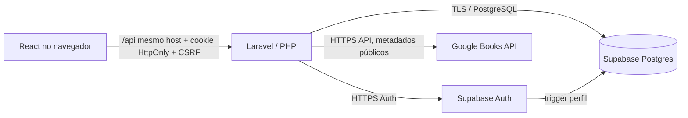

# 📚 Folha — Sistema de Biblioteca

> Plataforma de biblioteca com catálogo local, busca bibliográfica Google Books, conta de leitores, empréstimos controlados, painel de bibliotecários e API Laravel. Interface em português, código-fonte voltado à aprendizagem e implantação controlada.

   

## Sumário

1. [O projeto](#o-projeto)
2. [O que já existe](#o-que-já-existe)
3. [Visão de arquitetura](#visão-de-arquitetura)
4. [Estrutura de pastas](#estrutura-de-pastas)
5. [Pré-requisitos](#pré-requisitos)
6. [Instalação no Windows](#instalação-no-windows)
7. [Banco de dados](#banco-de-dados)
8. [Autenticação Google](#autenticação-google)
9. [Google Books API](#google-books-api)
10. [API REST](#api-rest)
11. [Segurança](#segurança)
12. [Testes e diagnóstico](#testes-e-diagnóstico)
13. [Ambiente de produção](#ambiente-de-produção)
14. [Limitações](#limitações)
15. [Créditos e referências](#créditos-e-referências)

## O projeto

O **Folha** ajuda uma biblioteca física a organizar o acervo e tornar a consulta mais acessível. Qualquer visitante pode visualizar livros disponíveis. Após fazer login, um leitor pode solicitar a retirada; um bibliotecário precisa aprovar e registrar a entrega física. A devolução é igualmente registrada pela equipe. Isso impede que o aplicativo confunda a consulta na internet com um empréstimo efetivo.

### O que já existe

| Módulo | Funcionalidade |
| --- | --- |
| Público | Início, catálogo local, busca por título/autor/tema, filtros, capa e detalhes |
| Descoberta | Pesquisa na Google Books API com título, capa, autores, descrição, ano e ISBN |
| Leitores | Cadastro por e-mail, login, fluxo Google OAuth via Supabase, perfil, solicitações e histórico |
| Bibliotecários | Resumo, autores, bibliotecas, cadastro/edição do acervo, busca de metadados no Google, retiradas, devoluções e acompanhamento |
| Estoque | Quantidade total e disponível, decremento/incremento em transações com triggers SQL |
| Infraestrutura | Docker Compose, React/Vite, PHP/Laravel, PostgreSQL no Supabase, scripts Windows |

**Regra fundamental:** resultados do Google Books **NÃO** são exemplares locais. Um título externo só entra na biblioteca quando um bibliotecário cadastra e confirma um exemplar físico.

## Visão de arquitetura



**Sessões:** a senha é enviada somente ao Supabase Auth durante login/cadastro. Tokens de sessão ficam na sessão **criptografada do Laravel, no servidor**. O navegador recebe um cookie `HttpOnly` contendo apenas o identificador da sessão; JavaScript não salva senha/tokens em `localStorage` ou `sessionStorage`. O cookie não elimina todos os riscos: XSS, CSRF, roubo de sessão, falhas de hospedagem e má configuração continuam relevantes.

**Banco de dados:** embora as tabelas tenham RLS habilitado, esta arquitetura BFF usa uma conexão direta do Laravel ao PostgreSQL. A autorização de clientes e bibliotecários **também** precisa ocorrer no PHP. Nunca use essa conexão em código executado no navegador.

## Estrutura de pastas

```text
biblioteca-segura/
├── backend/
│   ├── app/Http/Controllers/Api/  # autenticação, catálogo, Google Books, leitor e equipe
│   ├── app/Http/Middleware/       # validação Auth, papel e cache
│   ├── app/Support/               # query do catálogo
│   ├── routes/api.php             # endpoints REST
│   ├── config/                   # database, session, services, etc.
│   ├── .env.example               # apenas variáveis exemplo
│   └── Dockerfile
├── frontend/
│   ├── src/pages/                # Home, Catalog, Discover, BookDetail, Login, Admin...
│   ├── src/components/           # cards e navegação
│   ├── src/lib/api.js            # cliente HTTP com CSRF
│   └── vite.config.js            # proxy /api para Laravel
├── database/
│   ├── 01_base_supabase.sql
│   ├── 02_extensoes_catalogo.sql
│   ├── 03_dados_demonstracao_OPCIONAL.sql
│   ├── 04_api_somente_laravel.sql
│   └── 05_google_books.sql       # informativo; não há tabela para resultados externos
├── docs/SEGURANCA.md
├── docs/CHECKLIST_TESTES.md
├── TUTORIAL_WINDOWS.md
└── docker-compose.yml
```

## Pré-requisitos

- Windows 10/11 64-bit com virtualização e WSL2 habilitados, **Docker Desktop** executando.
- VS Code (opcional); navegador moderno.
- Um projeto Supabase com Auth e banco Postgres ativos.
- Conectividade à internet para baixar dependências, contatar Supabase e Google Books.
- Credenciais do banco PostgreSQL do projeto e chave **publishable** (não `service_role`).
- Para Google Login: configurar Google OAuth no Google Cloud e o provedor Google no Supabase.

## Instalação no Windows

1. Extraia o ZIP em uma pasta sem caracteres exóticos, por exemplo `C:\projetos\biblioteca-segura`. Abra a pasta no VS Code.
2. Crie o ambiente do Laravel no PowerShell, dentro da pasta raiz:

```powershell
Copy-Item .\backend\.env.example .\backend\.env
```

3. Edite **somente** `backend/.env` e preencha `DB_HOST`, `DB_PORT`, `DB_USERNAME`, `DB_PASSWORD`, `SUPABASE_URL` e `SUPABASE_PUBLISHABLE_KEY`. Pegue os dados do projeto real no Supabase. Para ambientes locais, `SESSION_SECURE_COOKIE=false`; **em produção**, use `true` com HTTPS.
4. No Dashboard do Supabase > **SQL Editor**, rode os arquivos `database/01_base_supabase.sql`, `02_extensoes_catalogo.sql`, `04_api_somente_laravel.sql` e `06_reforcos_integridade.sql`, **nessa ordem**, em um projeto novo e vazio. O arquivo `03_dados_demonstracao_OPCIONAL.sql` insere exemplos; não execute em dados de produção. O `05_google_books.sql` é informativo. **No projeto Supabase conectado, a migração `biblioteca_folha_schema_inicial_seguro` já foi aplicada; não execute novamente os arquivos 01/02/04/06 nesse mesmo projeto.**
5. Inicie o Docker Desktop. Na raiz do projeto:

```powershell
docker compose up --build
```

6. Abra **http://localhost:5173**. Para verificar a API: **http://localhost:5173/api/health** (deve responder JSON com `ok:true`).
7. Para parar: `Ctrl+C`, depois `docker compose down`. **Não** use `down -v` se quiser preservar volumes locais de sessão/dependências.

> O arquivo `frontend/index.html` **não é um site HTML independente**. Ele é a entrada do Vite/React e deve ser servido com `docker compose up` ou `npm run dev`.

Mais detalhes: [TUTORIAL_WINDOWS.md](TUTORIAL_WINDOWS.md).

## Banco de dados

Sete tabelas relacionais: `bibliotecas`, `autores`, `clientes`, `bibliotecarios`, `livros`, `emprestimos` e `solicitacoes`. `auth.users` é mantida pelo Supabase Auth; o perfil em `clientes` é criado por trigger após o cadastro. **Não há coluna `senha` nas sete tabelas.**

### Criar um bibliotecário

Por segurança, não existe botão público “virar administrador”. Primeiro faça cadastro/login normalmente no site. Depois, **somente um administrador de banco**, pelo SQL Editor, vincula o usuário autenticado à tabela `bibliotecarios`. Exemplo (ajuste o e-mail e a biblioteca):

```sql
INSERT INTO public.bibliotecarios (auth_user_id, nome, email, id_biblioteca)
SELECT u.id, 'Bibliotecário Responsável', u.email, b.id_biblioteca
FROM auth.users AS u
CROSS JOIN LATERAL (SELECT id_biblioteca FROM public.bibliotecas ORDER BY id_biblioteca LIMIT 1) b
WHERE u.email = 'responsavel@exemplo.com'
ON CONFLICT (auth_user_id) DO NOTHING;
```

É obrigatório ter uma biblioteca cadastrada antes. A autorização real é verificada no Laravel em cada requisição, por `auth_user_id` vindo do Supabase Auth validado. O acesso de equipe **não** deve ser decidido por e-mail, parâmetros enviados pelo cliente ou `user_metadata`.

**Banco já existente:** os SQLs de base foram feitos principalmente para instalação nova. Não use cegamente em base com dados sem backup, validação de esquema e migração incremental.

## Autenticação Google

1. Em Google Cloud Console, crie credenciais **OAuth Client ID** (tipo Web application), configure a tela de consentimento e os domínios de teste necessários.
2. Configure o **Authorized redirect URI** informado pelo Supabase: `https://<PROJECT_REF>.supabase.co/auth/v1/callback`.
3. No Supabase, abra **Authentication > Providers > Google** e configure Client ID/Client Secret **apenas lá**.
4. Em **Authentication > URL Configuration**, adicione `http://localhost:5173/api/auth/google/callback` na lista de redirecionamentos permitidos.
5. Faça login via botão “Continuar com Google”. O Laravel cria/verifica o PKCE e recebe o código de autorização; tokens não entram no JavaScript.

O domínio, as URLs e a configuração do projeto precisam coincidir. A API Laravel deve estar respondendo antes de tentar OAuth.

## Google Books API

A rota pública `GET /api/google-books?q=dom%20casmurro` chama `https://www.googleapis.com/books/v1/volumes` pelo Laravel. Parâmetros de busca são validados (de 2 a 120 caracteres, limites de paginação), a origem HTTPS é fixa e as respostas são normalizadas antes de chegar ao React.

O retorno contém `google_id`, `titulo`, `autores`, `descricao`, `imagem_capa_url`, `ano_publicacao`, `editora`, `isbn` e `info_url` quando disponíveis. O Google nem sempre fornece imagens ou sinopses, e não necessariamente lista todas as edições.

**Opcional:** em Google Cloud Console, ative a **Books API** e crie uma API key restrita. Configure exclusivamente `GOOGLE_BOOKS_API_KEY` no `backend/.env`. **Não** coloque essa chave em `VITE_...`, no JavaScript, em commit ou no README. Consultas sem chave podem funcionar conforme limites e política atual do Google; a chave pode ser necessária conforme cota/configuração.

A tela `/descobrir` faz a busca bibliográfica. No painel administrativo, em **Livros**, há uma ferramenta “Preencher dados usando Google Books”. Ela preenche os metadados do formulário para revisão manual; **não confirma estoque, autor ou aquisição automaticamente**.

Referência oficial: https://developers.google.com/books/docs/v1/using

## API REST

| Método e caminho | Público? | Descrição |
| --- | --- | --- |
| `GET /api/health` | Sim | Estado básico da API |
| `GET /api/livros` | Sim | Catálogo físico, com filtros e paginação |
| `GET /api/livros/destaques` | Sim | Destaques e livros solicitados |
| `GET /api/livros/{id}` | Sim | Detalhes de um exemplar do acervo |
| `GET /api/google-books?q=...` | Sim | Busca bibliográfica externa |
| `GET /api/auth/csrf` | Sim | Inicia sessão e fornece token CSRF |
| `POST /api/auth/register` | Sim + CSRF | Cadastro Supabase Auth |
| `POST /api/auth/login` | Sim + CSRF | Login Supabase Auth |
| `GET /api/auth/google` | Sim | OAuth2 Google com PKCE |
| `GET /api/auth/google/callback` | Sim | Conclusão OAuth via Laravel |
| `POST /api/auth/logout` | Sessão + CSRF | Logout e invalidação local |
| `GET /api/auth/me` | Leitor/equipe | Perfil da sessão atual |
| `GET /api/me/solicitacoes` | Leitor | Histórico de pedidos |
| `POST /api/me/solicitacoes` | Leitor | Nova solicitação, não baixa estoque |
| `GET /api/admin/dashboard` | Bibliotecário | Estatísticas |
| `POST /api/admin/livros` | Bibliotecário | Cadastro de exemplar local |
| `PATCH /api/admin/livros/{id}` | Bibliotecário | Atualização de metadados/total |
| `POST /api/admin/solicitacoes/{id}/emprestar` | Bibliotecário | Confirma retirada e baixa estoque |
| `POST /api/admin/emprestimos/{id}/devolver` | Bibliotecário | Confirma devolução e repõe estoque |

Rotas completas em [`backend/routes/api.php`](backend/routes/api.php). Endpoints protegidos **não aceitam identidade declarada pelo browser** como prova de autorização.

## Segurança

- Autenticação delegada ao Supabase Auth; não armazenamos senhas em tabelas próprias.
- Cookie de sessão `HttpOnly`, `SameSite=Lax`, expiração ao fechar o navegador e criptografia de sessão no servidor. `Secure=true` é obrigatório com HTTPS em produção.
- O React só usa `/api` no mesmo host, sem token persistente no navegador.
- Laravel verifica o usuário via endpoint `/auth/v1/user` a cada rota protegida; papel de bibliotecário obtido do banco, não de dados controlados pelo usuário.
- Rate limiting nos endpoints de login, cadastro, OAuth, Google Books e nas rotas autenticadas.
- Validação de dados e SQL parametrizado (Laravel Query Builder).
- Empréstimos e devoluções usam transações e triggers para atualizar estoque e preservar histórico.
- As sete tabelas têm RLS, e o script `04_api_somente_laravel.sql` retira permissões `anon`/`authenticated` de tabelas quando o único caminho é a API do servidor.
- `.env`/segredos, sessões, logs, `vendor` e `node_modules` são ignorados pelo Git.

**Atenção:** conectar Laravel ao banco usando `postgres` é uma permissão elevada; mantenha a conexão estritamente no servidor, proteja credenciais e use um usuário PostgreSQL de privilégio mínimo após configurar grants adequados. No ambiente final, configure TLS, proxies confiáveis, logs sem dados sensíveis, backup e monitoração. Nenhum projeto de exemplo deve ser considerado auditado para produção sem teste de integração, revisão de dependências e pentest.

Leia [docs/SEGURANCA.md](docs/SEGURANCA.md) e [docs/CHECKLIST_TESTES.md](docs/CHECKLIST_TESTES.md).

## Testes e diagnóstico

```powershell
# Na raiz do projeto:
.\scripts\diagnostico.ps1
.\scripts\test_api.ps1

docker compose ps
docker compose logs -f api
docker compose logs -f web

# Dentro do ambiente API:
docker compose exec api php artisan route:list
# Dentro do ambiente React:
docker compose exec web npm run build
```

Teste cadastro com e-mail confirmado, login/logout, Google OAuth, múltiplas tentativas de login, permissões de cliente versus admin, empréstimo simultâneo do último exemplar e devolução repetida. Os testes de ponta a ponta dependem do Supabase real.

## Ambiente de produção

**Este Docker Compose é para desenvolvimento local**, não é uma receita de deploy público. Antes de publicar o serviço: HTTPS/TLS em proxy reverso, `APP_ENV=production`, `APP_DEBUG=false`, `SESSION_SECURE_COOKIE=true`, origem e domínio corretos, proteção de headers, gerenciamento centralizado de segredos, logs sem tokens, backups, testes de CI e política de atualizações. Não exponha portas de administração nem o banco diretamente ao navegador.

## Limitações

- Metadados do Google Books não representam estoque real.
- Busca externa depende de internet, limites e disponibilidade da API Google.
- A interface permite criar perfis de leitor; contas administrativas exigem autorização manual no banco.
- A implementação não oferece pagamentos, multas, notificações ou reserva garantida de exemplares.
- A segurança deve ser reavaliada a cada alteração; dependências não estão integralmente fixadas por lockfiles nesta versão.
- **Não há afirmação de deploy público nem testes ponta a ponta sem execução real.**

## Créditos e referências

Projeto educacional de biblioteca desenvolvido com React, Laravel, PHP, Docker e Supabase. Metadados bibliográficos fornecidos pela **Google Books API**; sujeitos à disponibilidade e aos termos de uso do Google.

- https://developers.google.com/books/docs/v1/using
- https://supabase.com/docs/guides/auth
- https://supabase.com/docs/guides/database/postgres/row-level-security
- https://laravel.com/docs/12.x/csrf
- https://laravel.com/docs/12.x/session
- https://vite.dev/guide/
- https://docs.docker.com/compose/

**Licença:** nenhuma licença de código aberto foi escolhida nesta versão. Defina e inclua um arquivo `LICENSE` antes de estabelecer permissões de reutilização.
